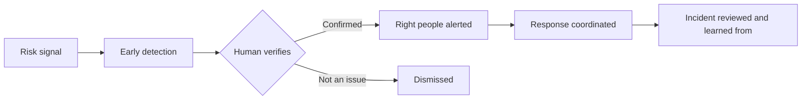

# 🛡️ Suraksha Bharat

### AI-assisted street safety, starting with women

*Making public spaces safer, so that no woman has to think twice before stepping out.*

[The Problem](#-the-problem) · [Our Approach](#-our-approach) · [Privacy](#-privacy-first) · [Roadmap](#-roadmap) · [Get Involved](#-get-involved)

---

## 🌙 The Problem

Many women plan their evenings around one question: *"Is this route safe?"*

- 🚶‍♀️ People change their plans after dark because of how unsafe a route feels.
- ⏱️ When something goes wrong, help often arrives late, because nobody who could help knew in time.
- 🧩 Safety information lives in separate systems that rarely talk to each other.

## 💡 Our Approach

> **Planned, not yet built.** This is the idea we are validating.

| Principle | What it means |
|---|---|
| **Detect early** | Spot potential risk situations, using infrastructure that already exists wherever possible |
| **Human in the loop** | AI flags, a person verifies, a person decides |
| **Alert the right people** | Quick, location-aware alerts to those who can actually help |
| **Learn from every incident** | Review what happened so the next response is faster |

## 🔐 Privacy First

Safety should not cost people their privacy. We plan to:

- Collect **only the data we need**
- Ask for **consent**
- Handle data **securely**
- Keep **people, not algorithms**, in charge of decisions

## 🧭 Roadmap

- [ ] Talk to students, hostel wardens and security staff about what breaks today
- [ ] Define one focused problem for a first pilot
- [ ] Build a small demo to test the idea
- [ ] Run a small, consent-based campus pilot
- [ ] Measure what matters: detection time, response time, false alarms
- [ ] Decide what to scale based on evidence

## 📍 Where We Are

**Idea stage.** No prototype yet. Validating the problem and looking for mentors and feedback.

## 🤝 Get Involved

Open to feedback, mentors and collaborators.

- 🛡️ Work in campus, city or women's safety? Tell us what actually goes wrong today.
- 💬 Faced this problem yourself? We would like to hear what would have helped.
- 🛠️ Want to help build it seriously? Reach out.

**Founder:** Arshiya Sharma  
**Connect:** [LinkedIn](https://www.linkedin.com/in/arshiya-sharma-a43809325/)

---

*Built in public. Honest about what's done and what isn't.*

